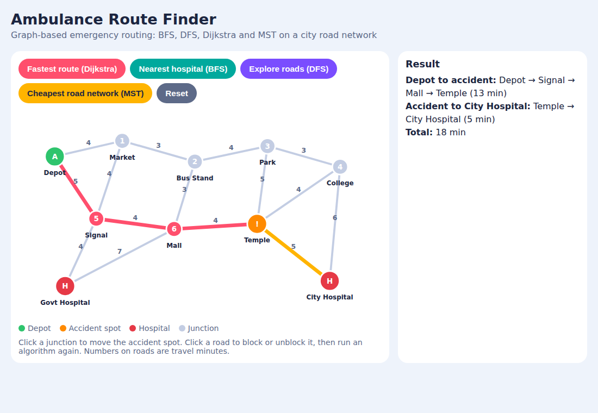

# Ambulance Route Finder

A Data Structures micro project that models a city road network as a weighted graph and finds the fastest ambulance route to an accident spot and then to the nearest hospital. If a road is blocked, the route is recomputed immediately.

**Course outcomes:** CO10 (graphs and traversal techniques for network problems) and CO5 (graph concepts for real-time applications)

## Features

- Road network stored as an adjacency matrix (junctions are vertices, travel time in minutes is the edge weight)
- **BFS** from the accident spot to find the hospital with the fewest road segments
- **DFS** from the depot to check connectivity and count all routes to the accident spot
- **Dijkstra** for the fastest route: depot to accident spot, then accident spot to nearest hospital
- **Prim's MST** for the minimum cost road network connecting all junctions
- **Road block re-routing**: block a road and get a new route without restarting

| Algorithm | Time complexity |
|---|---|
| BFS | O(V^2) |
| DFS | O(V^2) |
| Dijkstra (array version) | O(V^2) |
| Prim (matrix version) | O(V^2) |

## Project files

| File | Description |
|---|---|
| `ambulance_route_finder.c` | C program (main implementation) |
| `sample_input.txt` | Sample city map with 10 junctions and 15 roads |
| `index.html` | Colourful interactive dashboard that visualizes the same logic |

## How to run the C program

```
gcc ambulance_route_finder.c -o route
./route < sample_input.txt
```

Input order: number of junctions, junction names, number of roads, each road as `from to time`, depot number, accident junction number, number of hospitals, hospital junction numbers, and finally the blocked road as `from to`.

## Sample output

```
BFS from accident spot: Temple Park College Mall City_Hospital Bus_Stand Signal Govt_Hospital Market Depot 

DFS from depot: Depot Market Bus_Stand Park College Temple Mall Signal Govt_Hospital City_Hospital 
Road network is fully connected
Number of routes from depot to accident spot: 24

Fastest route (Dijkstra)
Depot to accident: Depot -> Signal -> Mall -> Temple (13 min)
Accident to nearest hospital: Temple -> City_Hospital (5 min)
Total time: 18 min

Minimum cost road network (Prim)
Depot - Market : 4
Market - Bus_Stand : 3
Bus_Stand - Mall : 3
Market - Signal : 4
Bus_Stand - Park : 4
Park - College : 3
College - Temple : 4
Signal - Govt_Hospital : 4
Temple - City_Hospital : 5
Total cost: 34

Route after blocking Mall - Temple
Depot to accident: Depot -> Market -> Bus_Stand -> Park -> Temple (16 min)
Accident to nearest hospital: Temple -> City_Hospital (5 min)
Total time: 21 min
```

## Dashboard

Open `index.html` in a browser. Click a junction to move the accident spot, click a road to block or unblock it, and use the buttons to run Dijkstra, BFS, DFS or MST.



## Author

Nishanthini M
